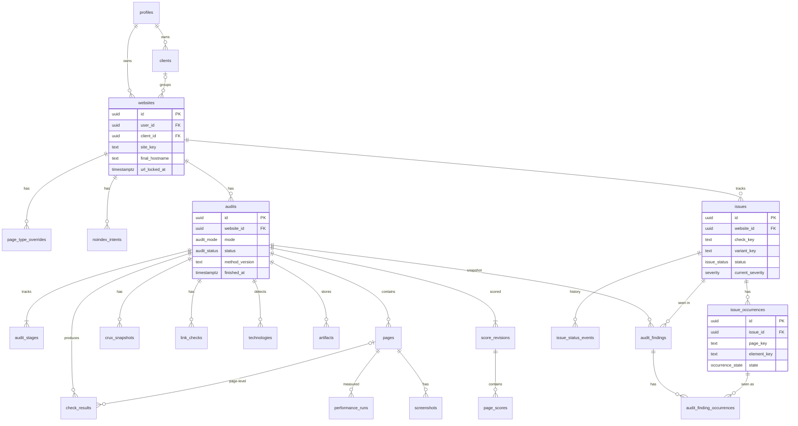

# SiteLens — Database and Data Architecture (DB)

**Status:** v1, approved by the product owner · 22 Nov 2026
**Database:** Supabase Postgres (Frankfurt), with Supabase Auth and Storage. The job queue is pg-boss, which keeps its own `pgboss` schema.
**Companion documents:** [PRD.md](PRD.md) · [Tech.md](Tech.md) · [UI-rules.md](UI-rules.md)

---

## 1. Conventions

**Naming and types**
- Table and column names use `snake_case`.
- Primary keys are `uuid` with the default `gen_random_uuid()`, unless a table says otherwise.
- Times are `timestamptz`.
- `created_at timestamptz not null default now()` is on every table and isn't repeated below.

**Vocabularies are Postgres enums.** New values are added with `ALTER TYPE … ADD VALUE`; values are never removed.

| Enum | Values |
|---|---|
| `user_role` | `user`, `admin` |
| `audit_mode` | `single_page`, `whole_site` |
| `audit_status` | `queued`, `running`, `completed`, `partially_completed`, `failed`, `cancelled` |
| `audit_stage` | `initialization`, `discovery`, `crawling`, `seo`, `performance`, `accessibility`, `technical_security`, `ux_automated`, `ai_content`, `ai_explanations`, `scoring`, `finalization` |
| `stage_status` | `pending`, `running`, `completed`, `failed`, `skipped`, `cancelled` |
| `category` | `seo`, `performance`, `accessibility`, `technical_security`, `ux_conversion` |
| `check_result` | `passed`, `warning`, `failed`, `not_applicable`, `unable_to_verify` |
| `severity` | `critical`, `high`, `medium`, `low` |
| `issue_status` | `open`, `in_progress`, `resolved`, `ignored` |
| `confidence` | `high`, `medium`, `low` |
| `finding_level` | `failure`, `warning`, `recommendation`, `informational` (PRD §7) |
| `device` | `mobile`, `desktop` |
| `page_status` | `scanned`, `excluded`, `failed`, `not_scanned_limit` |
| `page_type` | `homepage`, `service`, `product`, `product_listing`, `pricing`, `contact`, `about`, `blog_index`, `blog_post`, `landing`, `legal`, `other` |
| `detection_method` | `automated`, `manual_review`, `ai` |
| `ai_task` | `page_type_classification`, `page_content_analysis`, `executive_summary`, `finding_advice`, `visual_analysis` |
| `budget_bucket` | `free`, `pro`, `admin` |
| `reservation_kind` | `free_site_7d` (limit L6), `site_hourly` (limit L7) |
| `reservation_status` | `reserved`, `consumed`, `released` |
| `occurrence_state` | `open`, `resolved` |
| `artifact_kind` | `lighthouse_json`, `html_snapshot`, `ai_request`, `ai_response`, `pdf_report`, `data_export` |

**Ownership.** Every user-owned table carries `user_id uuid not null`. On child tables it is copied from the parent row, so row-level security (RLS) checks stay simple and fast (`user_id = auth.uid()`). The worker writes with the service role and sets `user_id` from the parent audit.

**Check definitions live in code**, in the `packages/core` check catalog: keys, tiers, base severities, rules and explanation texts. They are versioned by `method_version`.
- The database stores the `check_key`, plus a snapshot of the tier, credit and texts used.
- So an old audit always shows exactly what it was scored with, even after the catalog changes.

---

## 2. ER diagrams

### 2.1 Websites, audit snapshot and issues

### 2.2 Accounts, limits, billing, AI and sharing

```mermaid
erDiagram
  profiles ||--o{ subscriptions : has
  plans ||--o{ subscriptions : for
  plans ||--o{ profiles : "effective plan"
  profiles ||--o{ usage_ledger : uses
  profiles |o--o{ free_audit_claims : claimed
  profiles ||--o{ ip_audit_events : made
  audits ||--o{ site_reservations : reserves
  audits ||--o{ usage_ledger : charged
  audits ||--o{ ai_runs : costs
  pages ||--o| ai_page_analyses : analyzed
  audits ||--o| ai_summaries : summarized
  audit_findings ||--o| ai_advice : advised
  pages ||--o{ visual_analyses : "visual runs"
  visual_analyses ||--o{ ux_criterion_results : rates
  visual_analyses |o--o| score_revisions : creates
  audits ||--o{ public_reports : shared
  audits ||--o{ pdf_exports : exported
  profiles ||--o{ notifications : receives
  profiles ||--o{ admin_actions : performs
  demo_publications }o--o{ audits : publishes
  profiles ||--o{ deletion_requests : requests
  profiles ||--o{ data_exports : requests

  site_reservations {
    uuid id PK
    text site_key
    reservation_kind kind
    reservation_status status
    uuid audit_id FK
  }
  free_audit_claims {
    text email_hash PK
    uuid user_id FK
  }
  ai_runs {
    uuid id PK
    ai_task task
    text model
    numeric cost_usd
    budget_bucket bucket
  }
  public_reports {
    uuid id PK
    uuid audit_id FK
    bytea token_hash
    timestamptz revoked_at
  }
```

---

## 3. Tables

Columns marked **(snap)** belong to the unchangeable audit snapshot (§5). **Phase** says when a table is first used; every table is created in Phase 1, so later phases never need data migrations.

### 3.1 Accounts and billing

**`profiles`**: one row per `auth.users` row, created by a trigger on sign-up.

| Column | Type | Notes |
|---|---|---|
| `id` | uuid PK | References `auth.users(id)` on delete cascade |
| `email` | text not null | Copied from auth, for display |
| `display_name` | text | |
| `role` | `user_role` not null default `user` | Users can't update it (§4) |
| `plan_id` | text not null default `'free'` | References `plans(id)`. The effective plan, kept in sync by the Stripe webhook or an admin grant |
| `company_name` | text | Branding (Phase 2). Pro and admin only |
| `logo_path` | text | Storage path in `branding/` |
| `email_audit_ready` | boolean not null default true | The "audit ready" email (Phase 3) |
| `deleted_at` | timestamptz | Set when the user asks to delete the account; access ends |

**`plans`** (seeded with `free` and `pro`; readable by everyone)

| Column | Type | Notes |
|---|---|---|
| `id` | text PK | `free`, `pro` |
| `name` | text | |
| `audits_lifetime` | int | free: 1. null means no lifetime limit |
| `audits_per_period` | int | pro: 30 |
| `visual_lifetime` | int | free: 1 |
| `visual_per_period` | int | pro: 20 |
| `max_websites` | int | free: 1 · pro: 10 |
| `max_running_audits` | int not null | 1 |
| `max_credit_returns` | int | free: 3 · pro: null (no limit) |
| `custom_branding` | boolean | pro: true |
| `stripe_price_id` | text | Phase 3 |

**`subscriptions`** (Phase 3): written only by the Stripe webhook.

| Column | Type | Notes |
|---|---|---|
| `id` | uuid PK | |
| `user_id` | uuid not null | References `profiles` |
| `plan_id` | text not null | References `plans` |
| `stripe_customer_id` | text not null | |
| `stripe_subscription_id` | text unique not null | |
| `status` | text not null | Stripe's status: `active`, `trialing`, `past_due`, `canceled`, `unpaid`, `incomplete`… |
| `current_period_start` / `current_period_end` | timestamptz | Pro quotas count within this window |
| `cancel_at_period_end` | boolean | |
| `updated_at` | timestamptz | |

Index: `(user_id, status)`.

**`stripe_events`** (Phase 3): makes webhook handling idempotent.

| Column | Type | Notes |
|---|---|---|
| `id` | text PK | The Stripe event id. An insert conflict means the event was already handled |
| `type` | text | |
| `processed_at` | timestamptz | |
| `payload` | jsonb | Set to null after 90 days |

**`usage_ledger`**: allowances are counted from this append-only ledger.

| Column | Type | Notes |
|---|---|---|
| `id` | uuid PK | |
| `user_id` | uuid not null | |
| `kind` | text not null | `audit` or `visual_analysis` |
| `delta` | int not null | `-1` when used, `+1` when returned or granted |
| `reason` | text not null | `consume`, `return_failed`, `return_cancelled`, `admin_grant` |
| `audit_id` | uuid | References `audits`, on delete set null |
| `visual_analysis_id` | uuid | References `visual_analyses`, on delete set null |
| `actor_id` | uuid | The admin, for grants |

- Index: `(user_id, kind, created_at)`.
- **Used = −Σ delta.** For free, it is counted over the whole account life. For Pro, it is counted from `subscriptions.current_period_start`.
- **Returns** are counted with `reason like 'return_%'`.

### 3.2 Abuse limits (service role only)

**`free_audit_claims`** (limit L2): kept after the account is deleted.

| Column | Type | Notes |
|---|---|---|
| `email_hash` | text PK | HMAC-SHA256 of the normalized email, with a server-side secret |
| `user_id` | uuid | References `profiles`, on delete set null |
| `audit_id` | uuid | On delete set null |
| `claimed_at` | timestamptz not null | |

**`ip_audit_events`** (limit L4): purged after 30 days.

| Column | Type | Notes |
|---|---|---|
| `id` | uuid PK | |
| `ip_hash` | text not null | HMAC-SHA256 of the client IP |
| `user_id` | uuid | On delete set null |
| `audit_id` | uuid | On delete set null |

- Index: `(ip_hash, created_at)`.
- A row is deleted when its audit's credit is returned.

**`site_reservations`** (limits L6 and L7): purged after 30 days.

| Column | Type | Notes |
|---|---|---|
| `id` | uuid PK | |
| `site_key` | text not null | See PRD §12.2 |
| `kind` | `reservation_kind` not null | `free_site_7d` or `site_hourly` |
| `status` | `reservation_status` not null default `reserved` | Moves to `consumed` when the crawler first touches the site, or to `released` |
| `audit_id` | uuid not null | References `audits`, on delete cascade |
| `user_id` | uuid | On delete set null |
| `consumed_at` / `released_at` | timestamptz | |
| `release_reason` | text | `failed_before_crawl`, `cancelled_before_crawl`, `final_host_blocked`, `unsafe_url` |

- Index: `(site_key, kind, created_at) where status <> 'released'`.
- A reservation counts toward its window while it is `reserved` or `consumed`.

**`blocked_sites`** (limit L12)

| Column | Type | Notes |
|---|---|---|
| `site_key` | text PK | |
| `reason` | text | For example "Owner opt-out request" |
| `contact` | text | |
| `created_by` | uuid | The admin |

**`admin_actions`**: the audit log of admin activity.

| Column | Type | Notes |
|---|---|---|
| `id` | uuid PK | |
| `admin_id` | uuid | On delete set null |
| `action` | text not null | `limit_bypass`, `plan_grant`, `plan_revoke`, `report_disable`, `demo_publish`, `settings_change`, `site_block`, `site_unblock` |
| `target_type` / `target_id` | text / uuid | |
| `details` | jsonb | For `limit_bypass`: the rules that would have blocked the request (e.g. `["L7"]`) and the site key |

Index: `(action, created_at)`.

### 3.3 Websites

**`clients`**

| Column | Type | Notes |
|---|---|---|
| `id` | uuid PK | |
| `user_id` | uuid not null | |
| `name` | text not null | |
| `notes` | text | |
| `updated_at` | timestamptz | |

Unique index: `(user_id, lower(name))`.

**`websites`**

| Column | Type | Notes |
|---|---|---|
| `id` | uuid PK | |
| `user_id` | uuid not null | |
| `client_id` | uuid | References `clients`, on delete set null |
| `name` | text not null | Defaults to the hostname |
| `description` | text | |
| `entered_url` | text not null | Normalized |
| `entered_hostname` | text not null | |
| `final_hostname` | text | Set by the first audit, after the first redirect |
| `site_key` | text not null | Computed from the entered hostname |
| `indexing_intent` | text not null default `'indexed'` | `indexed` or `not_indexed` (a staging or private site). Applied from the next audit (PRD §5) |
| `url_locked_at` | timestamptz | Set when the first audit starts. A trigger rejects URL changes once it is set |
| `latest_audit_id` | uuid | The latest whole-site audit with an overall score |
| `latest_score` | smallint | From that audit's latest score revision |
| `last_audit_at` | timestamptz | |
| `updated_at` | timestamptz | |

- Unique index: `(user_id, site_key)`.
- Index: `(user_id, client_id)`.

**`page_type_overrides`**: user corrections, applied from the next audit.

| Column | Type | Notes |
|---|---|---|
| `id` | uuid PK | |
| `website_id` | uuid not null | On delete cascade |
| `user_id` | uuid not null | |
| `url_path` | text not null | Normalized path, e.g. `/blog/my-post` |
| `page_type` | `page_type` not null | |

Unique index: `(website_id, url_path)`.

**`noindex_intents`**: pages the user marked as intentionally noindex. Applied from the next audit (PRD §5).

| Column | Type | Notes |
|---|---|---|
| `id` | uuid PK | |
| `website_id` | uuid not null | On delete cascade |
| `user_id` | uuid not null | |
| `url_path` | text not null | Normalized path |

Unique index: `(website_id, url_path)`.

### 3.4 Audit snapshot

**`audits`**

| Column | Type | Notes |
|---|---|---|
| `id` | uuid PK | |
| `user_id` | uuid not null | |
| `website_id` | uuid not null | References `websites`, on delete cascade |
| `mode` | `audit_mode` not null | |
| `status` | `audit_status` not null default `queued` | |
| `current_stage` | `audit_stage` | |
| `priority` | smallint not null default 0 | admin: 10 |
| `plan_at_start` | text not null | `free`, `pro` or `admin`; decides the budget bucket |
| `entered_url` | text not null | |
| `entered_site_key` / `final_site_key` | text | |
| `final_url` | text | |
| `method_version` | text not null | **(snap)** e.g. `2026.1` |
| `crawler_version` / `lighthouse_version` / `axe_version` | text | **(snap)** |
| `pages_discovered` / `pages_scanned` / `pages_excluded` / `pages_failed` | smallint | **(snap)** |
| `coverage` | jsonb | **(snap)** Per-category coverage and missing categories |
| `queued_at` | timestamptz not null default now() | |
| `started_at` / `finished_at` | timestamptz | `finished_at` set means the snapshot is frozen (§5) |
| `heartbeat_at` | timestamptz | Updated by the worker every 15 s |
| `crawler_touched_at` | timestamptz | The first network request to the target site; consumes the L6/L7 reservations |
| `first_page_done_at` | timestamptz | Used for the credit-return rule |
| `cancel_requested_at` / `cancelled_at` | timestamptz | |
| `error_code` / `error_message` | text | See the error codes in Tech.md §6.4 |
| `ai_status` | text not null default `pending` | `pending`, `completed`, `failed`, `skipped_budget`. Can change after the audit finishes (one AI retry) |
| `ai_retry_used` | boolean not null default false | |
| `is_demo` | boolean not null default false | Published demo audits are kept by retention |

Indexes:
- `(website_id, finished_at desc)`
- `(user_id, status)`
- `(status, priority desc, queued_at)` for the queue position
- `(status, heartbeat_at) where status = 'running'` for the stuck-audit sweeper

**`audit_stages`**

| Column | Type | Notes |
|---|---|---|
| `audit_id` | uuid | Part of the primary key. On delete cascade |
| `stage` | `audit_stage` | Part of the primary key |
| `user_id` | uuid not null | |
| `status` | `stage_status` not null default `pending` | |
| `progress_done` / `progress_total` | smallint | For example, pages crawled out of the total |
| `started_at` / `finished_at` | timestamptz | |
| `error` | jsonb | Code, message, whether it can be retried |

**`pages`**: every discovered URL, not just the scanned ones.

| Column | Type | Notes |
|---|---|---|
| `id` | uuid PK | |
| `audit_id` | uuid not null | On delete cascade |
| `user_id`, `website_id` | uuid not null | |
| `url` / `normalized_url` / `url_path` | text not null | |
| `discovery_source` | text not null | `entered`, `homepage`, `navigation`, `homepage_link`, `internal_link`, `sitemap` |
| `discovery_rank` | smallint | |
| `status` | `page_status` not null | |
| `reason` | text | Exclusion or failure reason: `canonicalized`, `robots_disallowed`, `skipped_path`, `non_html`, `duplicate`, `login_required`, `bot_protection`, `timeout`, `http_error`, `too_large`, `unsafe_url` |
| `canonical_url` | text | |
| `http_status` | smallint | |
| `redirect_chain` | jsonb | |
| `content_type` | text | |
| `html_bytes` / `dom_elements` / `word_count` | int | |
| `page_type` | `page_type` | |
| `page_type_source` | text | `rules`, `ai` or `user_override` |
| `page_type_confidence` | `confidence` | |
| `language` | text | BCP 47 language code |
| `title` | text | |
| `load_ms` | int | |
| `scanned_at` | timestamptz | |

- Unique index: `(audit_id, normalized_url)`.
- Index: `(audit_id, status)`.
- The whole table is **(snap)**.

**`check_results`**: one row per check, per page (or per site), per device where the check is device-specific.

| Column | Type | Notes |
|---|---|---|
| `id` | uuid PK | |
| `audit_id` | uuid not null | On delete cascade |
| `user_id` | uuid not null | |
| `page_id` | uuid | Null for site-level checks |
| `check_key` | text not null | For example `seo.title_length` or `a11y.color-contrast` |
| `variant_key` | text not null default `''` | For example a header name or Lighthouse diagnostic id |
| `category` | `category` not null | |
| `device` | `device` | Null when the result covers both devices |
| `result` | `check_result` not null | |
| `level` | `finding_level` | Null when the result is `passed`, `not_applicable` or `unable_to_verify` |
| `scored` | boolean not null | False for advisory checks and for unscored outcomes. Scoring reads `result`, `level` and `scored` (PRD §8.1) |
| `severity` | `severity` | Null when the check passed or doesn't apply, and for informational findings. Always `low` for recommendations. Context rules are already applied |
| `detection_method` | `detection_method` not null | |
| `confidence` | `confidence` | UX checks |
| `tier` / `credit` | smallint / numeric(3,2) | Snapshot from the catalog |
| `measured` | jsonb | Values and thresholds, e.g. `{ "length": 72, "max": 60 }` |
| `evidence` | jsonb | An array of items: `selector`, `snippet`, `resource_url`, `screenshot_ref`, `devices`. Passed checks store none, to save space |

- Indexes: `(audit_id, category)`, `(audit_id, page_id)`, `(audit_id, check_key)`.
- The whole table is **(snap)**.

**`performance_runs`**

| Column | Type | Notes |
|---|---|---|
| `id` | uuid PK | |
| `audit_id`, `page_id`, `user_id` | uuid not null | |
| `device` | `device` not null | |
| `status` | text not null | `ok` or `failed` |
| `lighthouse_score` | smallint | 0–100 |
| `lcp_ms`, `tbt_ms`, `fcp_ms`, `speed_index_ms`, `ttfb_ms` | int | |
| `cls` | numeric(6,3) | |
| `opportunities` | jsonb | `[ { id, title, savings_ms, savings_bytes } ]` |
| `lighthouse_version` | text | |
| `raw_artifact_id` | uuid | References `artifacts`. The gzipped Lighthouse JSON, kept 90 days |
| `error_code` | text | |

Unique index: `(page_id, device)`. **(snap)**

**`crux_snapshots`**

| Column | Type | Notes |
|---|---|---|
| `id` | uuid PK | |
| `audit_id`, `user_id` | uuid not null | |
| `page_id` | uuid | Null for whole-site data |
| `scope` | text not null | `url` or `origin` |
| `form_factor` | text not null | `phone` or `desktop` |
| `status` | text not null | `ok`, `no_data` or `failed` |
| `lcp_p75_ms`, `inp_p75_ms`, `fcp_p75_ms`, `ttfb_p75_ms` | int | |
| `cls_p75` | numeric(6,3) | |
| `histograms` / `collection_period` | jsonb | |

**(snap)**

**`link_checks`**

| Column | Type | Notes |
|---|---|---|
| `id` | uuid PK | |
| `audit_id`, `user_id` | uuid not null | |
| `url` | text not null | |
| `is_internal` | boolean not null | |
| `status_code` | smallint | |
| `result` | text not null | `ok`, `broken`, `redirect`, `server_error`, `unable_to_verify` |
| `final_url` | text | |
| `redirect_hops` | smallint | |
| `error_code` | text | |
| `found_on` | jsonb | `[ { page_id, selector, anchor_text } ]` |

Unique index: `(audit_id, url)`. **(snap)**

**`technologies`**

| Column | Type | Notes |
|---|---|---|
| `id` | uuid PK | |
| `audit_id`, `user_id` | uuid not null | |
| `name` | text not null | |
| `category` | text | |
| `version` | text | |
| `confidence` | `confidence` | |
| `evidence` | jsonb | |

**(snap)**

**`screenshots`**

| Column | Type | Notes |
|---|---|---|
| `id` | uuid PK | |
| `audit_id`, `page_id`, `user_id` | uuid not null | |
| `device` | `device` not null | |
| `storage_path` | text not null | |
| `width_css` / `height_css` | int | Height is capped at 16,000 CSS px |
| `pixel_ratio` | numeric(3,1) | 1 on desktop, 2 on mobile |
| `bytes` | int | |
| `truncated` | boolean | |
| `retain_until` | timestamptz | `created_at` + 90 days. Set to null (keep with the audit) when a public report, PDF or visual analysis uses it |
| `deleted_at` | timestamptz | |

Unique index: `(page_id, device)`. **(snap)**, except `retain_until` and `deleted_at`.

**`artifacts`**: raw files in Storage.

| Column | Type | Notes |
|---|---|---|
| `id` | uuid PK | |
| `user_id` | uuid not null | |
| `audit_id` | uuid | On delete cascade |
| `kind` | `artifact_kind` not null | |
| `storage_path` | text not null | |
| `bytes` | int | |
| `content_encoding` | text | `gzip` |
| `expires_at` | timestamptz | Raw files: +90 days. Data exports: +7 days |
| `deleted_at` | timestamptz | |

Index: `(expires_at) where deleted_at is null`.

### 3.5 Issues (change across audits)

**`issues`**

| Column | Type | Notes |
|---|---|---|
| `id` | uuid PK | |
| `website_id` | uuid not null | On delete cascade |
| `user_id` | uuid not null | |
| `check_key` / `variant_key` | text not null | |
| `category` | `category` not null | |
| `detection_method` | `detection_method` not null | `automated` or `manual_review` |
| `title` | text not null | From the latest audit's catalog snapshot |
| `current_severity` | `severity` not null | Recalculated every audit |
| `level` | `finding_level` not null | From the latest audit: `failure`, `warning` or `recommendation` |
| `status` | `issue_status` not null default `open` | |
| `status_note` | text | Private note |
| `status_changed_at` | timestamptz | |
| `status_changed_by` | uuid | Null when the system changed it |
| `resolution_verified` | boolean | Set when the next audit no longer detects the issue |
| `is_regression` | boolean not null default false | |
| `related_issue_ids` | uuid[] | Cross-category links, e.g. SEO alt text and axe `image-alt` |
| `first_detected_audit_id` / `last_detected_audit_id` | uuid | |
| `first_detected_at` / `last_detected_at` | timestamptz | |
| `open_occurrences` | int not null default 0 | Cached count |
| `updated_at` | timestamptz | |

- Unique index: `(website_id, check_key, variant_key)`.
- Indexes: `(user_id, status, current_severity)`, `(website_id, category)`.

**`issue_occurrences`**

| Column | Type | Notes |
|---|---|---|
| `id` | uuid PK | |
| `issue_id` | uuid not null | On delete cascade |
| `user_id` | uuid not null | |
| `page_key` | text not null | Normalized URL, or `''` for site-level checks |
| `element_key` | text not null default `''` | Selector or resource URL |
| `state` | `occurrence_state` not null | |
| `first_seen_audit_id` / `last_seen_audit_id` / `resolved_in_audit_id` | uuid | |
| `first_seen_at` / `last_seen_at` / `resolved_at` | timestamptz | |

- Unique index: `(issue_id, page_key, element_key)`.
- Index: `(issue_id, state)`.

**`issue_status_events`**: the full status history.

| Column | Type | Notes |
|---|---|---|
| `id` | uuid PK | |
| `issue_id` | uuid not null | On delete cascade |
| `user_id` | uuid not null | |
| `actor` | text not null | `user` or `system` |
| `actor_id` | uuid | |
| `from_status` / `to_status` | `issue_status` | |
| `reason` | text not null | `manual`, `auto_resolved`, `reopened_still_detected`, `regression`, `verified` |
| `audit_id` | uuid | The audit that triggered the change |
| `note` | text | |

**`audit_findings`**: what an audit found, frozen with that audit.

| Column | Type | Notes |
|---|---|---|
| `id` | uuid PK | |
| `audit_id` | uuid not null | On delete cascade |
| `issue_id` | uuid not null | On delete cascade |
| `user_id` | uuid not null | |
| `check_key`, `variant_key`, `category` | | Snapshot |
| `severity` | `severity` not null | Severity in this audit |
| `level` | `finding_level` not null | Level in this audit: `failure`, `warning` or `recommendation`. Informational results stay in `check_results` only and never create findings or issues (PRD §10.2) |
| `detection_method` | `detection_method` not null | |
| `title`, `description`, `impact`, `recommendation` | text | Catalog texts used for this method version |
| `occurrence_count` / `pages_affected` | int | |
| `is_new` | boolean | First detected in this audit |
| `advice_rank` | smallint | 1–15 when it is among the top findings that get AI advice |

- Unique index: `(audit_id, issue_id)`.
- Index: `(audit_id, severity)`.
- **(snap)**

**`audit_finding_occurrences`**

| Column | Type | Notes |
|---|---|---|
| `id` | uuid PK | |
| `audit_finding_id` | uuid not null | On delete cascade |
| `audit_id`, `user_id` | uuid not null | |
| `occurrence_id` | uuid | References `issue_occurrences`, on delete set null |
| `page_id` | uuid | Null for site-level checks |
| `element_key` | text | |
| `devices` | `device`[] | |
| `evidence` | jsonb | |
| `check_result_id` | uuid | |

**(snap)**

### 3.6 Scores

**`score_revisions`**: rows are only ever added. Revision 0 is the audit's original score.

| Column | Type | Notes |
|---|---|---|
| `id` | uuid PK | |
| `audit_id` | uuid not null | On delete cascade |
| `user_id` | uuid not null | |
| `revision` | smallint not null | 0 = original |
| `reason` | text not null | `initial` or `visual_analysis` |
| `visual_analysis_id` | uuid | |
| `overall_score` | smallint | Null means "Insufficient data" |
| `is_provisional` | boolean not null | A category is missing |
| `seo_score`, `performance_score`, `accessibility_score`, `technical_security_score`, `ux_conversion_score` | smallint | Null when the category has no score |
| `caps_applied` | jsonb | `[ { category, cap, reason_check_key } ]` |
| `coverage` | jsonb | |
| `ux_ai_coverage` | jsonb | `{ analyzed_pages, scanned_pages }` |
| `method_version` | text not null | |

- Unique index: `(audit_id, revision)`.
- The latest revision is `max(revision)`, exposed through the `audit_latest_scores` view.

**`page_scores`**

| Column | Type | Notes |
|---|---|---|
| `revision_id` | uuid | Part of the primary key. References `score_revisions`, on delete cascade |
| `page_id` | uuid | Part of the primary key |
| `category` | `category` | Part of the primary key |
| `user_id` | uuid not null | |
| `score` | smallint | |
| `details` | jsonb | For UX: the automated and AI parts, and whether the page is automated-only. For performance: the mobile and desktop scores and the partial flag |

### 3.7 AI

**`ai_runs`**: one row per model call. Used for cost and budget. Users can't read it (§4).

| Column | Type | Notes |
|---|---|---|
| `id` | uuid PK | |
| `user_id` | uuid | On delete set null; the row is kept for cost totals |
| `audit_id` / `page_id` / `visual_analysis_id` | uuid | On delete set null |
| `task` | `ai_task` not null | |
| `model` | text not null | e.g. `claude-sonnet-5-5` |
| `bucket` | `budget_bucket` not null | |
| `status` | text not null | `succeeded`, `failed`, `invalid_output` |
| `attempt` | smallint not null | |
| `input_tokens`, `output_tokens`, `cache_read_tokens`, `cache_write_tokens` | int | |
| `cost_usd` | numeric(10,6) | Calculated from the price table in `settings` |
| `latency_ms` | int | |
| `request_artifact_id` / `response_artifact_id` | uuid | Prompts and responses, kept 90 days |
| `error_code` | text | |

Indexes: `(bucket, created_at)`, `(audit_id)`, `(created_at)`.

**`ai_page_analyses`**

| Column | Type | Notes |
|---|---|---|
| `id` | uuid PK | |
| `audit_id`, `page_id`, `user_id` | uuid not null | |
| `ai_run_id` | uuid | |
| `observations` | jsonb | AI findings in the PRD §9.2 shape |
| `suggestions` | jsonb | Rewrites, only for checks that didn't pass |

Unique index: `(page_id)`. **(snap)** once successful.

**`ai_summaries`**

| Column | Type | Notes |
|---|---|---|
| `id` | uuid PK | |
| `audit_id` | uuid unique not null | |
| `user_id` | uuid not null | |
| `ai_run_id` | uuid | |
| `summary` | text not null | |
| `priorities` / `strengths` | jsonb | |

**(snap)** once successful.

**`ai_advice`**

| Column | Type | Notes |
|---|---|---|
| `id` | uuid PK | |
| `audit_finding_id` | uuid unique not null | |
| `audit_id`, `user_id` | uuid not null | |
| `ai_run_id` | uuid | |
| `advice` | text not null | |
| `steps` | jsonb | |

**(snap)**

**`visual_analyses`** (Phase 2)

| Column | Type | Notes |
|---|---|---|
| `id` | uuid PK | |
| `audit_id`, `page_id`, `website_id`, `user_id` | uuid not null | |
| `run_number` | smallint not null | |
| `status` | text not null | `queued`, `running`, `succeeded`, `failed` |
| `is_latest` | boolean not null default false | True for the latest successful run |
| `model` | text | |
| `sections` | jsonb | `{ desktop: n, mobile: n, partially_analyzed: bool, analyzed_height_css }` |
| `strengths`, `issues`, `recommendations`, `suggestions`, `accessibility_observations` | jsonb | |
| `ai_run_id` | uuid | |
| `score_revision_id` | uuid | |
| `finished_at` | timestamptz | |

- Unique index: `(audit_id, page_id, run_number)`.
- Partial unique index: `(audit_id, page_id) where is_latest`.

**`ux_criterion_results`** (Phase 2)

| Column | Type | Notes |
|---|---|---|
| `id` | uuid PK | |
| `visual_analysis_id` | uuid not null | On delete cascade |
| `user_id` | uuid not null | |
| `criterion_key` | text not null | e.g. `ux.ai.cta_prominence` |
| `result` | `check_result` not null | Only `passed`, `warning` or `failed` |
| `confidence` | `confidence` not null | |
| `tier` | smallint | |
| `evidence` | text | |
| `section_ref` | jsonb | `{ device, index, y_from, y_to }` |

### 3.8 Sharing, notifications and the app

**`public_reports`** (Phase 2)

| Column | Type | Notes |
|---|---|---|
| `id` | uuid PK | |
| `audit_id` | uuid not null | On delete cascade |
| `user_id` | uuid not null | |
| `token_hash` | bytea unique not null | SHA-256 of a random 32-byte token. The raw token is shown once, as part of the URL |
| `include_ignored` | boolean not null default false | |
| `expires_at` / `revoked_at` | timestamptz | |
| `disabled_by_admin_at` | timestamptz | |
| `disabled_reason` | text | |
| `view_count` | int not null default 0 | |
| `last_viewed_at` | timestamptz | |

**`pdf_exports`** (Phase 2)

| Column | Type | Notes |
|---|---|---|
| `id` | uuid PK | |
| `audit_id`, `user_id` | uuid not null | |
| `score_revision_id` | uuid | A new PDF is made if the latest revision changes |
| `artifact_id` | uuid | |
| `branding` | jsonb | Snapshot of the company name and logo path |
| `status` | text | `queued`, `ready`, `failed` |

**`notifications`**

| Column | Type | Notes |
|---|---|---|
| `id` | uuid PK | |
| `user_id` | uuid not null | |
| `type` | text not null | `audit_completed`, `audit_partially_completed`, `audit_failed`, `visual_analysis_completed`, `pdf_ready`, `export_ready` |
| `audit_id` | uuid | On delete cascade |
| `payload` | jsonb | |
| `read_at` | timestamptz | |

Index: `(user_id, read_at, created_at desc)`.

**`settings`**: runtime configuration. Only the admin can change it.

| Column | Type | Notes |
|---|---|---|
| `key` | text PK | |
| `value` | jsonb not null | |
| `updated_by` | uuid | |
| `updated_at` | timestamptz | |

Seeded keys:

| Key | Value |
|---|---|
| `ai.models` | Model per task |
| `ai.prices` | USD per million input and output tokens, per model |
| `ai.free_monthly_budget_usd` | 10 |
| `ai.free_audit_estimate_usd` | 0.85 |
| `limits.free_daily_audits` | 5 |
| `limits.free_site_days` | 7 |
| `limits.site_hourly` | 3 |
| `limits.ip_free_per_30d` | 2 |
| `worker.global_concurrency` | 2 |
| `crawl.*` | The PRD §6.4 values |

**`demo_publications`** (Phase 3)

| Column | Type | Notes |
|---|---|---|
| `id` | uuid PK | |
| `version` | int not null | |
| `website_ids` / `audit_ids` | uuid[] not null | |
| `default_audit_id` | uuid not null | |
| `pdf_artifact_id` | uuid | |
| `is_active` | boolean not null | |
| `published_by` | uuid | |

Partial unique index: `(is_active) where is_active`.

**`deletion_requests`** (Phase 3)

| Column | Type | Notes |
|---|---|---|
| `id` | uuid PK | |
| `user_id` | uuid not null | |
| `requested_at` | timestamptz not null | |
| `completed_at` | timestamptz | |

**`data_exports`** (Phase 3)

| Column | Type | Notes |
|---|---|---|
| `id` | uuid PK | |
| `user_id` | uuid not null | |
| `status` | text | `queued`, `ready`, `failed` |
| `artifact_id` | uuid | |
| `completed_at` | timestamptz | |

### 3.9 System

**`job_outbox`** (service role only): a transactional outbox between the database and the worker's pg-boss queues.
- **Why it exists:** a job can't be lost, and the web app never needs a direct Postgres connection (Tech.md §2).
- **How it works:** the RPCs that start work insert a row here in the same transaction. These are `start_audit`, `start_visual_analysis`, `retry_ai`, `create_pdf_export`, `request_data_export` and the delete functions (for Storage cleanup). An insert trigger then sends `NOTIFY job_outbox`.

| Column | Type | Notes |
|---|---|---|
| `id` | bigint identity PK | |
| `job_name` | text not null | `audit.run`, `audit.ai_retry`, `visual.run`, `report.pdf`, `export.run`, `storage.cleanup` |
| `payload` | jsonb not null | For example `{ "audit_id": "…" }` |
| `priority` | smallint not null default 0 | |
| `singleton_key` | text | For example the `audit_id`, so the same work is never queued twice |
| `dispatched_at` | timestamptz | Set once the job is in pg-boss |

- Index: `(dispatched_at) where dispatched_at is null`.
- Rows that have been dispatched are deleted after 7 days.

---

## 4. Access policies (RLS)

RLS is **enabled on every table**.
- The worker and server-only code use the **service role**, which bypasses RLS.
- The admin page reads with the service role after checking `profiles.role = 'admin'` on the server. There are no admin RLS policies.

| Table(s) | select | insert | update | delete |
|---|---|---|---|---|
| `profiles` | own row | trigger only | own row: only `display_name`, `company_name`, `logo_path`, `email_audit_ready` (column grants). `role` and `plan_id` can't be changed | — (through account deletion) |
| `plans` | any signed-in user | — | — | — |
| `clients`, `page_type_overrides`, `noindex_intents` | own | own | own | own |
| `websites` | own | own (through the quick box or a form) | own; a trigger blocks URL columns once `url_locked_at` is set | `delete_website()` RPC only |
| `audits` and every snapshot table (`audit_stages`, `pages`, `check_results`, `performance_runs`, `crux_snapshots`, `link_checks`, `technologies`, `screenshots`, `audit_findings`, `audit_finding_occurrences`, `score_revisions`, `page_scores`, `ai_page_analyses`, `ai_summaries`, `ai_advice`, `visual_analyses`, `ux_criterion_results`) | own | service role (audits through `start_audit()`) | service role; `audits.cancel_requested_at` through the `cancel_audit()` RPC | `delete_audit()` RPC only |
| `issues`, `issue_occurrences`, `issue_status_events` | own | service role | `set_issue_status()` RPC only (Phase 2) | cascade |
| `public_reports` | own | `create_public_report()` RPC, which returns the raw token once | own: revoke (`revoked_at`), `include_ignored` | own |
| `pdf_exports`, `data_exports` | own | RPC (queues the job) | service role | cascade |
| `notifications` | own | service role | own: `read_at` only | own |
| `subscriptions`, `usage_ledger` | own | service role | service role | — |
| `artifacts` | own (metadata) | service role | service role | service role |
| `free_audit_claims`, `ip_audit_events`, `site_reservations`, `blocked_sites`, `admin_actions`, `settings`, `stripe_events`, `ai_runs`, `demo_publications`, `deletion_requests`, `job_outbox` | service role only | service role | service role | service role |

**Public reports and the demo** never give anonymous users access to tables.
- The Next.js server validates the token (or the active demo publication).
- It then reads only the allowed audit IDs with the service role.
- Files are served through short-lived signed URLs.

**Realtime.** Progress updates use `postgres_changes` on `audits` and `audit_stages`, filtered by `id` / `audit_id`. These subscriptions respect RLS.

---

## 5. How audit snapshots stay unchanged

- **Once `audits.finished_at` is set,** a `BEFORE UPDATE OR DELETE` trigger on every **(snap)** table rejects changes. These are the only exceptions:
  - columns that retention manages (`screenshots.retain_until`, `screenshots.deleted_at`, and `artifacts.deleted_at`);
  - `audits.ai_status` and `audits.ai_retry_used`, which change during the one AI retry;
  - deletes made by `delete_website()`, `delete_audit()` and the account purge. These functions set `app.allow_snapshot_delete = on` for their transaction.
- **Rows can still be added to a finished audit** in three cases:
  - a successful AI retry, in the `ai_*` tables;
  - a visual analysis, in `visual_analyses`, `ux_criterion_results`, `score_revisions` and `page_scores`;
  - a PDF export.

  Rows that already exist are never rewritten.
- **Score revision 0 can never change.** Later revisions are new rows.
- **Issues are the only state that changes across audits.** Their history is in `issue_status_events`, and each audit's view of them is frozen in `audit_findings`.

---

## 6. Database functions (RPC)

All of these are `SECURITY DEFINER` with `search_path` pinned. Functions that enforce limits can be executed **only by the service role**, so the browser can't call them directly. They return typed error codes, which the UI turns into messages (UI-rules.md §9).

### 6.1 `start_audit()`

The atomic reservation (PRD §12). Its arguments are `p_user_id`, `p_website_id` (null when the quick box creates the website), `p_client_id`, `p_entered_url`, `p_entered_site_key`, `p_mode`, `p_email_hash` and `p_ip_hash`. It returns `(audit_id, error_code, retry_after)`.

**Before calling it, the server action:**
- confirms the session;
- normalizes the URL and computes its site key;
- runs the SSRF pre-check (DNS);
- verifies Turnstile (free plan, Phase 3);
- computes the HMAC hashes. The secret never enters the database.

**Inside one transaction, the function:**
1. Locks the profile with `SELECT … FOR UPDATE`, which serializes requests from the same account. If the email isn't verified, it stops with `EMAIL_NOT_VERIFIED`.
2. Checks **L12**: a site in `blocked_sites` stops with `SITE_BLOCKED`. This applies to everyone, admin included.
3. Takes `pg_advisory_xact_lock(hashtext('site:' || p_entered_site_key))`, which serializes requests for the same site.
4. Evaluates the remaining rules in this order. **For the admin, no rule blocks the request. Each rule that would have blocked it is recorded in `admin_actions` (`limit_bypass`, with the rule numbers).**

   | Check | Rule | Error code |
   |---|---|---|
   | L10 | 1 queued or running audit per account | `AUDIT_ALREADY_RUNNING` |
   | Website limit | When a new website is being created | `WEBSITE_LIMIT` |
   | L1 (free) | Ledger usage below 1, and returns below 3 | `FREE_AUDIT_USED` |
   | L2 (free) | Insert into `free_audit_claims`. A conflict with a different `user_id` fails | `FREE_EMAIL_USED` |
   | L4 (free) | Fewer than 2 rows in `ip_audit_events` in the last 30 days | `FREE_NETWORK_LIMIT` |
   | L9 (free) | Fewer than 5 free audits started today (UTC) | `FREE_AUDITS_PAUSED` (`retry_after` = tomorrow) |
   | L8 (free) | This month's free AI spend + estimates for running free audits + this estimate ≤ $10 | `FREE_AUDITS_PAUSED` (`retry_after` = 1st of next month) |
   | L11 (Pro) | Usage this period below 30 | `PRO_QUOTA_EXHAUSTED` (`retry_after` = `current_period_end`) |
   | **L6 (free)** | No `free_site_7d` reservation for this site key that is `reserved` or `consumed` in the last 7 days | **`FREE_SITE_LIMIT`** (`retry_after` = oldest reservation + 7 days) |
   | **L7 (everyone but the admin)** | Fewer than 3 `site_hourly` reservations (`reserved` or `consumed`) in the last hour | `SITE_HOURLY_LIMIT` (`retry_after` = oldest one + 1 hour) |

5. **Writes the new rows:**
   - the `websites` row, if it is new, with `url_locked_at = now()`;
   - the `audits` row (`queued`, with priority 10 for the admin and 0 otherwise);
   - **always** a `site_hourly` reservation, including for the admin, because the limit protects site owners;
   - for the free plan, a `free_site_7d` reservation and an `ip_audit_events` row;
   - a `usage_ledger` `consume` entry (not for the admin);
   - any `admin_actions` bypass rows.
6. Inserts a `job_outbox` row (`audit.run`, with the audit's priority and `singleton_key = audit_id`) in the **same transaction**. The trigger sends `NOTIFY`, and the worker's dispatcher moves the job into pg-boss.
7. Returns the `audit_id`.

**Messages never reveal other users' data.** Errors carry only a code and a `retry_after`.

### 6.2 Worker-side functions

| Function | What it does |
|---|---|
| `mark_crawler_touched(audit_id)` | Sets `crawler_touched_at` and moves its reservations to `consumed`. Called just before the first network request to the target site |
| `reserve_final_site(audit_id, final_site_key)` | Called after the first redirect when the final key is different. Re-checks L12, L6 and L7 for the final key under its own advisory lock, and inserts the reservations. If they block, it marks the audit `failed` (with the matching error code), releases the entered key's reservations (`final_host_blocked`), returns the credit and returns the error |
| `finish_audit(audit_id, status)` | Sets the final status and `finished_at`. It also applies the return rules:  • If the audit is `failed`, or `cancelled` before `first_page_done_at`: a `return_*` row is added to `usage_ledger` (when the plan's return limit allows), and the `ip_audit_events` row is deleted.  • If `crawler_touched_at` is null: the reservations are released (`failed_before_crawl` or `cancelled_before_crawl`). |
| Issue lifecycle (worker transaction, not a SQL function) | `packages/core/issues` works out the changes from the audit's findings (PRD §10.3). In the `finalization` stage, the worker applies them in **one transaction**: it upserts `issues` and `issue_occurrences`, writes `issue_status_events`, and updates the `websites.latest_*` columns for whole-site audits |
| `sweep_stale_audits()` | Runs every minute. A `running` audit with no heartbeat for 3 minutes is finalized as `partially_completed` if it has scanned pages, or `failed` otherwise (`WORKER_INTERRUPTED`) |
| `queue_position(audit_id)` | The number of `queued` audits ahead of it, ordered by `priority desc, queued_at` |

### 6.3 Functions users call

| Function | What it does |
|---|---|
| `cancel_audit(audit_id)` | Sets `cancel_requested_at` on the user's own `queued` or `running` audit. A queued audit becomes `cancelled` immediately |
| `retry_ai(audit_id)` | Allowed once, when `ai_status = 'failed'` and `ai_retry_used = false`. Queues `audit.ai_retry` |
| `set_issue_status(issue_id, status, note)` (Phase 2) | Checks ownership and writes the status and an `issue_status_events` row |
| `start_visual_analysis(audit_id, page_id)` (Phase 2) | Same pattern as `start_audit`: locks the account and checks the visual-analysis quota, the free plan's single analysis on its free audit, and L8 for free. Then it inserts `visual_analyses` (`queued`) and a ledger row |
| `create_public_report(audit_id, expires_at, include_ignored)` (Phase 2) | Generates the token, stores its hash and returns the raw token once |
| `delete_website(id, confirm_hostname)`, `delete_audit(id, confirm_hostname)` | Check the typed confirmation, delete in cascade and queue removal of the Storage files |
| `request_data_export()`, `request_account_deletion()` (Phase 3) | Queue the matching jobs |

---

## 7. Storage

| Bucket | Path | Contents | Access |
|---|---|---|---|
| `audit-files` (private) | `{user_id}/{audit_id}/screenshots/{page_id}-{device}.webp` | Full-page screenshots: WebP quality 75, height capped at 16,000 CSS px | The owner can read files under their own `user_id` prefix. Writes use the service role. Public reports and the demo use signed URLs |
| | `{user_id}/{audit_id}/lighthouse/{page_id}-{device}.json.gz` | Raw PageSpeed and Lighthouse response, kept 90 days | Service role |
| | `{user_id}/{audit_id}/html/{page_id}.html.gz` | Rendered HTML snapshot, kept 90 days | Service role |
| | `{user_id}/{audit_id}/ai/{ai_run_id}-{request,response}.json.gz` | AI prompts and responses, kept 90 days | Service role |
| | `{user_id}/{audit_id}/pdf/{pdf_export_id}.pdf` | PDF report | The owner reads it through a signed URL |
| `branding` (private) | `{user_id}/logo.{png,jpg,webp}` | The user's logo. Max 1 MB; **SVG isn't allowed** | The owner can write to their own prefix. Reads use signed URLs |
| `exports` (private) | `{user_id}/{export_id}.zip` | GDPR data export, kept 7 days | Signed URL |

**Deleting files.** Database cascades can't delete Storage objects. Instead, the delete functions add the affected paths to a `storage.cleanup` pg-boss job, and the worker removes them.

---

## 8. Retention and deletion jobs

These are scheduled pg-boss jobs that run in the worker.

| Job | Schedule | Action |
|---|---|---|
| `retention.artifacts` | daily | Deletes Storage objects and marks `deleted_at` for `artifacts` past `expires_at` |
| `retention.screenshots` | daily | Deletes screenshots past `retain_until`, unless the audit `is_demo` |
| `retention.limits` | daily | Deletes `ip_audit_events` and `site_reservations` older than 30 days, and clears `stripe_events.payload` older than 90 days |
| `retention.account_purge` | daily | Handles `deletion_requests`. It deletes the `auth.users` row, which cascades to `profiles` and every owned row, then removes the user's Storage prefixes. `free_audit_claims` keep their `email_hash` (with `user_id` set to null). `admin_actions` and `ai_runs` keep anonymized rows. Done within 30 days, normally the same day |
| `sweep_stale_audits` | every minute | See §6.2 |
| `queue.reconcile` | every minute | Dispatches any `job_outbox` rows a missed `NOTIFY` left behind (the dispatcher also polls every 10 s), and deletes dispatched rows older than 7 days |

**Setting `retain_until` to null.** When a public report, PDF or visual analysis uses an audit, the RPC that creates it sets `retain_until = null` on that audit's screenshots (PRD §13).

---

## 9. Size estimates and migrations

**Size**
- **Per whole-site audit (10 pages):** about 1,000–1,500 `check_results` rows (around 50 relevant axe rules × 10 pages × devices, plus about 90 other checks). Passed checks store no evidence.
- **Total:** about **1–2 MB of database space per whole-site audit**, plus 15–25 MB of files.
- **Supabase Free** (500 MB database, 1 GB of files) holds roughly 40–60 audits with screenshots. **Supabase Pro** (8 GB database, 100 GB of files) holds thousands. The move to Pro happens before the public launch (Phase 3).

**Migrations**
- All schema changes are SQL migrations in `supabase/migrations/`, created with the Supabase CLI and checked into git.
- **Locally:** `supabase start`, then `supabase db reset` applies migrations and seed data (`supabase/seed.sql`: plans, settings and a development admin).
- **Production:** `supabase db push`, run by hand in Phase 1 and from GitHub Actions on `main`, with approval, from Phase 3.
- **Generated types:** `supabase gen types typescript` writes them to `packages/core/src/db/types.ts`, and CI fails if they're out of date.
- **Tests:** pgTAP tests in `supabase/tests/` cover the RLS policies, the snapshot trigger and every `start_audit` limit, including concurrent calls.
