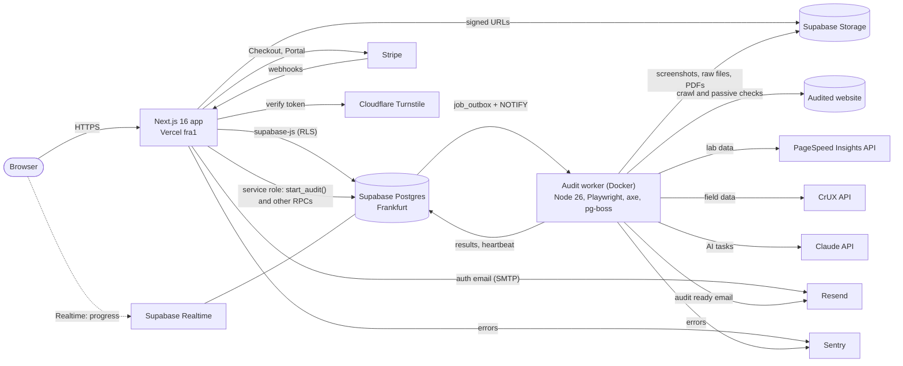

# SiteLens — Technology and Architecture (Tech)

**Status:** v1.2 · approved by the product owner 22 Nov 2026, updated 23 Nov 2026 (see the change log at the end)
**Companion documents:** [PRD.md](PRD.md) · [DB.md](DB.md) · [UI-rules.md](UI-rules.md)

---

## 1. Stack and key choices

| Area | Choice | Why |
|---|---|---|
| Web app | **Next.js 16.4** (App Router), **React 19.3**, TypeScript 5, Tailwind CSS 4.3, **shadcn/ui** (preset `base-lyra`, Base UI primitives, Hugeicons) | Already in the repo. Server Components keep data access on the server |
| Hosting (web) | **Vercel**, functions in `fra1` (Frankfurt), **Node 26** | Owner's choice. The functions sit next to the database |
| Database, auth, storage, realtime | **Supabase** (Frankfurt): Postgres, Auth, Storage, Realtime | Owner's choice. One system with one access model (RLS) |
| Background jobs | **pg-boss**, a queue inside Postgres | No extra service. Supports priorities, retries and schedules |
| Audit worker | **Node 26 LTS** in **Docker**, with **Playwright (Chromium)** and **axe-core** | Audits run up to 15 min with a real browser, which serverless functions can't do |
| Node.js | **Node 26 LTS everywhere:** local development, CI, the worker image and Vercel | One version, so behavior matches between environments |
| Lab performance data | **PageSpeed Insights API v5** (Lighthouse on Google's servers) | Consistent hardware and free. Only the Performance category is requested |
| Field performance data | **Chrome UX Report (CrUX) API** | Free. Google plans to remove CrUX data from PageSpeed responses |
| AI | **Claude API** through `@anthropic-ai/sdk`, behind a thin internal wrapper | One provider. The model per task is a setting |
| Payments (Phase 3) | **Stripe** Checkout, Customer Portal, webhooks | Owner's choice (PRD §3) |
| Email (Phase 3) | **Resend**, also used as Supabase Auth's custom SMTP | Supabase's built-in email can't send to real users |
| Bot check (Phase 3) | **Cloudflare Turnstile** | Free and privacy-friendly |
| Monitoring | **Sentry** (web and worker), **Vercel Web Analytics** (cookieless), structured JSON logs | |
| Monorepo | **pnpm** workspaces | Owner's choice |
| Tests and CI | **Vitest**, **pgTAP** (`supabase test db`), Playwright Test later, **GitHub Actions** | |

**Next.js 16 note.** This version has breaking changes compared to older Next.js. Before writing Next.js code, read the guides bundled in `node_modules/next/dist/docs/` (see `AGENTS.md`). Key differences:
- **Middleware is now `proxy.ts`** (`01-getting-started/16-proxy.md`). It is meant for optimistic checks, not for authorization.
- **Caching uses Cache Components**: `cacheComponents: true` and the `'use cache'` directive (`01-getting-started/08-caching.md`).
- **Typed route props:** `LayoutProps` and `PageProps` are used for routes.

---

## 2. Architecture



**How an audit flows:**
1. A Server Action validates the request and calls `start_audit()` with the service role (DB.md §6.1).
2. In the same transaction, `start_audit()` inserts the audit and a `job_outbox` row, then sends `NOTIFY job_outbox`.
3. The worker LISTENs for that notification (and also polls every 10 s), moves the outbox row into pg-boss, and runs the job.
4. The worker writes progress and results with the service role.
5. The browser receives progress through Supabase Realtime, with polling as a fallback.

**Why an outbox.** The web app never opens a direct Postgres connection from serverless functions. The audit and its job are created atomically, so a job can't be lost.

**Worker hosting**
- **Phases 1–2:** the worker runs on the owner's PC with Docker Desktop, connected to the hosted Supabase project. Audits run only while it's on.
- **Phase 3:** a container host in an EU region (Railway, Fly.io or Render; PRD open item O5). Each instance needs 2–4 GB of RAM.

---

## 3. Repository layout

```
/                          pnpm workspace root (main branch: main)
├─ apps/
│  ├─ web/                 Next.js 16 app. The current create-next-app moves here,
│  │                       keeping the preset files (components.json, globals.css, fonts)
│  │  ├─ AGENTS.md         Next.js agent rules, generated by `next dev` and committed
│  │  └─ .env.local        local env values for web (gitignored)
│  └─ worker/              Audit worker: pg-boss jobs, pipeline, browser, integrations
│     └─ .env              local env values for the worker (gitignored)
├─ packages/
│  └─ core/                Shared and framework-free:
│     ├─ catalog/          check definitions, tiers, severities, explanation texts (versioned)
│     ├─ checks/           check functions over page and site snapshots (no browser)
│     ├─ scoring/          scoring, caps, coverage, severity rules
│     ├─ issues/           issue identity and lifecycle (works out the changes)
│     ├─ url/              normalization, site key, discovery filters
│     ├─ net/              SSRF guard: IP-range checks and a safe DNS lookup
│     ├─ ai/               wrapper, prompts (*.v1.md), Zod schemas, evidence validation
│     └─ db/               generated Supabase types and shared query types
├─ supabase/               config.toml, migrations/, seed.sql, tests/ (pgTAP)
├─ fixtures/sample-site/   static site with known problems, for the integration test
├─ .github/workflows/      ci.yml
├─ docs/                   PRD.md, DB.md, Tech.md, UI-rules.md (the source of truth)
├─ tasks/                  Tasks.md (the task list and workflow) and one plan file per task
├─ AGENTS.md               rules for coding agents
├─ package.json            root scripts, packageManager, engines
├─ pnpm-workspace.yaml     workspace packages: apps/*, packages/*
├─ tsconfig.base.json      shared compiler options
├─ tsconfig.json           solution file: project references to every package
├─ eslint.config.mjs       the single ESLint config
├─ vitest.config.ts        the single Vitest config (one project per package)
├─ .env.example            every environment variable, with comments
```

- **TypeScript** uses project references.
- **Linting** uses a single root ESLint 9 flat config. The `eslint-config-next` rules apply to `apps/web`, and the TypeScript rules to all packages.
- **Imports:** `packages/core` contains no imports of Next.js, Playwright, React or UI libraries, `@supabase/*` or the apps, so it can be unit-tested and shared. An ESLint rule enforces this.
- **Core source:** the apps import core's TypeScript source through `@sitelens/core/<module>`. Core has no runtime build; `tsc -b` emits only declarations, to `.tsbuild/`, for type checking.

---

## 4. Web app (Next.js 16)

### 4.1 Routes

| Area | Routes | Phase |
|---|---|---|
| Marketing and legal | `/` (landing), `/bot` (crawler info), `/privacy`, `/terms` | `/` and `/bot`: 1 · legal pages: 3 |
| Auth | `/sign-in`, `/sign-up` (Phase 3), `/auth/callback` (Route Handler for the OAuth and email code exchange) | 1 |
| App (signed in) | `/overview` · `/websites`, `/websites/[websiteId]`, `/websites/[websiteId]/compare` · `/audits`, `/audits/[auditId]` (progress view or results Overview), `/audits/[auditId]/{issues,pages,performance,technical}`, `/audits/[auditId]/pages/[pageId]` · `/issues`, `/issues/[issueId]` · `/reports` · `/settings/{profile,branding,billing,notifications,privacy}` · `/upgrade` | Mostly 1. Compare and reports: 2. Billing and upgrade: 3 |
| Admin | `/admin/{users,costs,limits,models,blocked-sites,reports,demo,activity}` | 3 |
| Demo | `/demo` (redirects to the default demo audit), with mirrors of the app routes under `/demo/...` | 3 |
| Public report | `/r/[token]` | 2 |
| Internal | `/print/audits/[auditId]` (signed and short-lived, used for the PDF), `/api/stripe/webhook`, `/unsubscribe` | 2–3 |

### 4.2 Data access and auth

- **Sessions:** `@supabase/ssr` creates the Supabase clients for Server Components, Server Actions and Route Handlers, using cookie-based sessions.
- **`proxy.ts`** only refreshes the session cookie and does optimistic redirects (signed out → `/sign-in`). **Authorization happens in a server-side data access layer** (`lib/dal.ts`): `requireUser()`, `requireAdmin()`, `requireOwner(resource)`. Every Server Action calls one of them first.
- **Reads** go through the user-scoped client, so RLS applies.
- **The service-role client** is used only in server-only modules (`import 'server-only'`) for:
  - limit-enforcing RPCs;
  - public reports and the demo;
  - the admin page;
  - Stripe webhooks.
- **Writes** go through **Server Actions** that call RPCs (`start_audit`, `cancel_audit`, `set_issue_status`…) or update the user's own rows. Inputs are validated with the Zod schemas from `packages/core`.
- **Google sign-in:** Supabase Auth's Google provider; the callback is handled by `/auth/callback`.
- **Sign-in allowlist (Phases 1–2):**
  - `ALLOWED_EMAILS` is a comma-separated list of email addresses.
  - Matching: trim spaces and lowercase both sides, then compare exactly. There are no wildcards and no Gmail normalization.
  - **It fails closed:** when the variable is empty or not set, nobody can sign in.
  - It is checked in two places:
    - the `/auth/callback` Route Handler, which signs a non-allowlisted user out again and shows `EMAIL_NOT_ALLOWED` (UI-rules §9.4);
    - the DAL guards (`requireUser()`, `requireAdmin()`, `requireOwner()`), so an existing session stops working when an email is taken off the list.
  - The admin's email must be on the list too.
  - It is removed in Phase 3, together with the variable.
- **Email/password (Phase 3):** Supabase email confirmations sent through Resend as custom SMTP. Disposable email domains (L3) are checked in the sign-up Server Action before calling Supabase.
- **Admin:** the `role` column is set by hand in SQL.

### 4.3 Rendering and caching

- **Cache Components is enabled** (`cacheComponents: true`).
- **Signed-in pages** render dynamically, with Suspense skeletons that match the final layout.
- **`'use cache'` with `cacheTag`** is used only for data that never changes and isn't tied to a user:
  - the content of published demo audits (tag `demo`, invalidated when the demo is republished);
  - audit content for public reports (tag `audit:<id>:rev:<n>`).
- **The token check for a public report is never cached,** so revoking a link takes effect immediately.
- **Before writing cache code,** confirm the exact cache APIs in the bundled docs.

### 4.4 Live progress

- **Realtime:** the progress view subscribes to `postgres_changes` on `audits` (`id=eq.<id>`) and `audit_stages` (`audit_id=eq.<id>`). These subscriptions respect RLS.
- **Fallback:** if the channel isn't connected within 5 s, or drops, the client polls a Server Action every 5 s.
- **Queue position:** comes from `queue_position(audit_id)`. The estimate uses a rolling median audit duration.

### 4.5 Demo (Phase 3)

- **Shared pages:** the app and the demo render **the same page components**. Each page gets its data from an `AuditDataSource` interface, which has two implementations:
  - `UserDataSource`: RLS-scoped reads;
  - `DemoDataSource`: service-role reads limited to the IDs in the active `demo_publications` row.
- **Actions** are passed in as props. In the demo they open a "Create a free account to do this" dialog, and status changes are kept in client state only.
- **Demo routes import no Server Actions,** so nothing can write from the demo.

### 4.6 Security headers for SiteLens itself

SiteLens sets the headers it checks other sites for, so it passes its own Technical checks:
- **CSP with a nonce per request.** Set in `proxy.ts`, following the bundled `content-security-policy` guide.
- **The other headers:** HSTS, `X-Content-Type-Options: nosniff`, `Referrer-Policy: strict-origin-when-cross-origin`, `Permissions-Policy`, and `frame-ancestors 'none'`.
- **Public reports** also send `X-Robots-Tag: noindex, nofollow` and `Referrer-Policy: no-referrer`, so the token never leaks through the referer.

---

## 5. Supabase

The schema, RLS, functions and retention are specified in [DB.md](DB.md).

**Connections**
- **Web:** supabase-js only.
- **Worker:** `pg` (node-postgres) for transactional writes and pg-boss, plus supabase-js for Storage.
- **Worker connection string:** use the **Supavisor session-mode pooler**, which supports IPv4. The direct connection may be IPv6-only. Check this during setup.
- **Write path:** all writes from the worker go through the service role.

**Projects**
- **Local:** `supabase start` in Docker, with local Studio and the built-in email catcher.
- **Production:** a Frankfurt project, on the Free plan during Phases 1–2 and **Pro before the public launch**.

**Storage:** private buckets only, served through signed URLs (DB.md §7).

---

## 6. Worker and audit pipeline

### 6.1 Process and queues

One Node process runs:
- the **outbox dispatcher**: LISTEN on `job_outbox`, plus a poll every 10 s;
- **pg-boss workers**;
- the **heartbeat loop**;
- the **scheduled jobs**.

| Queue | Concurrency (per worker) | Notes |
|---|---|---|
| `audit.run` | `settings.worker.global_concurrency` (2) | The admin's audits use priority 10 |
| `audit.ai_retry` | 1 | The single AI retry after a failed AI stage |
| `visual.run` (Phase 2) | 1 | |
| `report.pdf` (Phase 2) | 1 | |
| `export.run`, `storage.cleanup` | 1 | |
| Schedules | — | `retention.*`, `sweep_stale_audits`, `queue.reconcile` (DB.md §8) |

**Global concurrency** equals the number of worker instances × the per-instance concurrency. There is one instance until the load requires more.

**Browser:** one Chromium instance per process, with a **fresh browser context for each page and device**.
- At most **2 page loads at once per audit** (PRD §6.4), and 4 per process.
- Chromium restarts after 20 audits, or when it crashes.

### 6.2 Pipeline, stage by stage

Each stage writes its `audit_stages` row: status, progress and errors. The UI shows the stages in the brief's order. Some of them run at the same time, as noted below.

1. **`initialization`**
   - Loads the audit and settings.
   - Re-checks the URL with the SSRF guard. If it is unsafe, the audit ends `failed` with `UNSAFE_URL` and its reservations are released.
   - Calls `mark_crawler_touched()` just before the first request.
   - Follows the first redirect and stores the `final_url`. If the hostname changed, it calls `reserve_final_site()`.
   - Fetches and parses `robots.txt` with the `robots-parser` library (rules for `SiteLensBot` first, then `*`).
   - Records the method, crawler, axe and Lighthouse versions.
2. **`discovery`** (whole site)
   - Renders the homepage and collects links from header and `nav` landmarks, then main-content links, in the order from PRD §6.2.
   - Normalizes each URL (`packages/core/url`), applies the filters (exact hostname, skipped paths, non-HTML, robots.txt) and removes duplicates.
   - Reads the sitemap (robots.txt `Sitemap:` or `/sitemap.xml`, with index files followed up to 5 files and 50,000 URLs in total) as the last source.
   - Picks up to 10 pages. Canonicalized pages are swapped for the next candidate.
   - Writes **every** discovered URL to `pages`, with its outcome.
3. **`crawling`**: for each selected page, desktop (1440×900, DPR 1) and mobile (390×844, DPR 2, touch, mobile user agent):
   - **Loading:**
     - navigates with a 30 s timeout, waiting for `load` and then up to 5 s of network idle;
     - scrolls in steps to trigger lazy-loaded content (at most 10 s);
     - records the main-document response (status, headers, **raw HTML** before JavaScript runs, capped at 10 MB), the redirect chain, the cookies set (`context.cookies()`), and failed resource requests.
   - **Data collection:**
     - extracts DOM data with `page.evaluate`: meta tags, headings, links, images and their natural and rendered sizes, forms, the main text, computed styles for the UX checks, and bounding boxes for the first viewport and overlaps;
     - runs **axe** with `@axe-core/playwright`, tags `wcag2a`, `wcag2aa`, `wcag21a`, `wcag21aa`, `wcag22aa` and `best-practice`;
     - runs the extra browser checks: focus visibility by tabbing through the first 20 focusable elements, and reflow at 320 px;
     - **mobile only:** checks for horizontal overflow, pop-ups covering the page, and whether the menu toggle works.
   - **Files:**
     - takes a full-page screenshot (capped at 16,000 CSS px tall) and converts it with `sharp` to WebP quality 75 before uploading;
     - stores the rendered HTML (`page.content()`) gzipped, for 90 days.
   - **Page type:** classifies the page with rules first; if they aren't confident, Haiku decides (`page_type_classification`). An override in `page_type_overrides` always wins.
   - **Login walls and bot protection:** detected from known markers (`cf-mitigated`, challenge titles, CAPTCHA iframes, password forms). The page is then marked `failed` with the reason. **No attempt is made to get around them.**
   - **Certificate errors:** the browser context uses `ignoreHTTPSErrors: true`, so the page can still be audited while `tech.certificate_valid` fails.
   - **Progress:** `first_page_done_at` is set after the first page's renders finish.
4. **`seo`, `technical_security`, `accessibility`, `ux_automated`**
   - **Check functions** in `packages/core/checks` run on the collected page and site data. They are pure functions, so they can be unit-tested without a browser.
   - **Network checks** run in the worker through the SSRF-safe HTTP client:
     - `http://` to `https://` redirect, the `www` variant, redirect chains;
     - **TLS:** `tls.connect` with SNI, then `getPeerCertificate()`, `authorized` and expiry;
     - **link checks:** HEAD with a GET fallback, 10 s timeout, at most 5 redirects; internal links capped at 300 and external at 200; at most 2 requests at once per external host;
     - `robots.txt` and sitemap validation.
5. **`performance`**: **starts right after discovery and runs alongside crawling.**
   - **PageSpeed:** `GET https://www.googleapis.com/pagespeedonline/v5/runPagespeed`, with `url`, `strategy=MOBILE|DESKTOP`, `category=PERFORMANCE` and `key`.
     - Each call has a 90 s timeout, with 4 calls at once per worker and one retry on 429, 5xx or timeout.
     - The raw JSON is stored gzipped. Metrics and failing diagnostics are extracted, and the Lighthouse version is recorded.
   - **CrUX:** `POST https://chromeuxreport.googleapis.com/v1/records:queryRecord` with `{ url | origin, formFactor: PHONE | DESKTOP }`.
     - A 404 means no data.
     - Calls are throttled on the client to stay under 150 per minute.
     - CrUX failures are shown as "Real-user data unavailable" and don't make the audit `partially_completed`.
6. **`ai_content`:** `page_content_analysis` for each scanned page, 3 at a time (§8).
7. **`ai_explanations`:**
   - scores are first **calculated in memory** (a pure function; the summary needs them);
   - then `finding_advice` runs for the top 15 findings, followed by the `executive_summary`.
8. **`scoring`:** saves score revision 0 and the page scores, using `packages/core/scoring` (PRD §8).
9. **`finalization`:**
   - builds the `audit_findings` and their occurrences, and applies the **issue lifecycle** in one transaction (`packages/core/issues` works out the changes and the worker applies them);
   - updates the website's `latest_*` columns;
   - calls `finish_audit()`, which sets the final status and returns credits and releases reservations where the rules say so;
   - creates the notification and, in Phase 3, sends the "audit ready" email.

**Single-page mode** skips discovery. It renders only the entered URL, but runs every site-level check.

### 6.3 Timing, cancellation and failure handling

**Time budget.** The audit has a **15-minute** deadline, enforced with an `AbortController`:

| Work | Must end by |
|---|---|
| Crawling, checks and PageSpeed | Minute 11 |
| AI | Minute 14 |
| Finalization | Minute 15 |

If a deadline passes, the remaining work in that stage is skipped and the audit ends `partially_completed` with `AUDIT_TIME_LIMIT`.

**Heartbeat.** The worker updates `heartbeat_at` every 15 s and reads `cancel_requested_at` every 2 s.

**Cancellation:**
- aborts in-flight navigations, fetches and PageSpeed calls;
- closes browser contexts and marks unfinished stages `cancelled`;
- keeps completed rows and calls `finish_audit('cancelled')`;
- targets **≤10 s** from the click to the `cancelled` status.

**Stuck audits.** `sweep_stale_audits()` closes any audit whose heartbeat is older than 3 minutes (DB.md §6.2).

**Retries:**
- **Temporary errors** are retried **once** after 2–5 s: network timeouts, `ECONNRESET`, 429, 502, 503 and 504.
- **Permanent errors** are never retried: DNS NXDOMAIN, 4xx responses, TLS validation failures, invalid output after the repair attempt.
- Every error is saved with its code and class.

### 6.4 Error codes

| Code | Class | Retried? | Effect |
|---|---|---|---|
| `INVALID_URL` | input | no | Rejected before `start_audit` |
| `UNSAFE_URL` | input | no | Rejected, or the audit fails before the crawl and its reservations are released |
| `DNS_NOT_FOUND` | target | no | Page `failed`. On the homepage, the audit is `failed` |
| `CONNECTION_FAILED`, `TIMEOUT` | target | once | Page `failed` with the reason |
| `HTTP_ERROR` | target | once for 5xx | Page `failed`. A 5xx feeds `tech.server_errors`; on the homepage, `tech.availability` |
| `TLS_ERROR` | target | no | Recorded as `tech.certificate_valid` failing. The page is still loaded |
| `BOT_PROTECTION` | target | no | Page `failed`. On the homepage, the audit is `failed` |
| `LOGIN_REQUIRED` | target | no | Page `failed`, shown as "Unable to verify — login required" |
| `TOO_LARGE` | target | no | Page `failed` (HTML over 10 MB) |
| `PSI_FAILED`, `PSI_QUOTA` | integration | once | That device's result is missing; the page is flagged partial |
| `CRUX_FAILED` | integration | once | Field data unavailable (not partial) |
| `AI_FAILED`, `AI_INVALID_OUTPUT` | integration | once (one repair attempt for invalid output) | `ai_status = failed`; the banner offers one retry |
| `AI_BUDGET` | limit | no | `ai_status = skipped_budget` (free bucket only) |
| `AUDIT_TIME_LIMIT` | system | no | `partially_completed` |
| `WORKER_INTERRUPTED` | internal | no | Set by the sweeper |
| `INTERNAL_ERROR` | internal | no | Reported to Sentry |
| Limit codes from DB.md §6.1 | limit | no | Shown with their message (UI-rules.md §9) |

---

## 7. Security

### 7.1 SSRF protection

The code lives in `packages/core/net` and the worker's HTTP client. There are several layers.

1. **URL rules:**
   - `http` or `https` only, on ports **80 and 443** only;
   - no `user:pass@` in the URL;
   - hostnames like `localhost`, `*.local`, `*.internal` and single-label names are rejected;
   - IP-literal hosts are checked like resolved addresses.
2. **DNS check:** every A and AAAA record is checked with `ipaddr.js`. Anything other than **public unicast** is blocked:
   - IPv4: `0/8`, `10/8`, `100.64/10`, `127/8`, **`169.254/16` (cloud metadata)**, `172.16/12`, `192.0.0/24`, `192.0.2/24`, `192.168/16`, `198.18/15`, `198.51.100/24`, `203.0.113/24`, `224/4`, `240/4`;
   - IPv6: `::1`, `::`, `fc00::/7`, `fe80::/10`, `ff00::/8`, `2001:db8::/32`;
   - IPv4-mapped and NAT64 IPv6 addresses are checked against the IPv4 rules.
3. **Pinned connections.** The Node HTTP client uses an `undici` Agent with a custom `lookup` that validates every connection, so DNS rebinding between the check and the connection doesn't work. Redirects are followed by hand (`redirect: 'manual'`) and every hop is checked again.
4. **The browser:** `page.route('**/*')` checks each request's host with the same resolver (cached per audit) and aborts blocked ones. Service workers are blocked. WebSocket and other non-HTTP requests to blocked addresses are aborted.
5. **Network level (Phase 3):** the worker host gets **egress firewall rules** that deny private, link-local and metadata ranges, so the browser's own DNS lookups can't reach internal addresses either.
   - **Phases 1–2 accepted risk:** the worker runs on the owner's PC, and only people on the sign-in allowlist (§4.2) can start audits. That limits who can reach this remaining gap, so the risk is accepted until the worker moves to a host.
6. **Exceptions:**
   - the PDF job may call the app's own origin through a signed print URL (explicit allowlist);
   - `SSRF_TEST_ALLOWLIST` allows `localhost` **only when `NODE_ENV=test`**, for the fixture site.

### 7.2 Browser isolation
- Runs on the official Playwright Docker image (`mcr.microsoft.com/playwright:v<version>-noble`, version pinned and matching the `playwright` npm package) as the **non-root `pwuser`**. From Playwright 1.65 this image ships **Node 26**, so no other base image or Node install is needed. Checked 23 Nov 2026 against the `v1.65.1` Dockerfile. If a pinned version ever ships an older Node, Node 26 is installed on top of the same image. The container runs with Chromium's sandbox **enabled** and Playwright's recommended seccomp profile. `--no-sandbox` is never used in production.
- Every page gets a fresh context with:
  - no downloads (`acceptDownloads: false`) and all permissions denied;
  - dialogs dismissed automatically and pop-ups closed;
  - nothing saved between pages.
- Container memory is capped at 2–4 GB with a CPU quota. Chromium is killed if a page hangs past its timeout.

### 7.3 Passive checks only
The worker only performs normal page loads, `HEAD`/`GET` requests to discovered URLs, and TLS handshakes.
- **No attack traffic:** no payloads, form submissions, login attempts, port scans or fuzzing.
- **Forms** are inspected, never submitted.

### 7.4 Secrets, tokens and hashing
- **Secrets** live only in environment variables (§11).
  - **The repo is public:** `.env*` is gitignored, `.env.example` is committed, and GitHub secret scanning is on.
  - **The service-role key** is never in a `NEXT_PUBLIC_*` variable and never in client code.
- **Public report tokens:** 32 random bytes encoded as `base64url`. Only their SHA-256 hash is stored, and lookup is by hash.
- **Hashing emails and IPs:** both use HMAC-SHA256 with `HASH_SECRET`, which is **never rotated**, because rotating it would break limit L2.
  - **Client IP:** read from Vercel's `x-forwarded-for` (first entry) or `x-real-ip`. These are trusted only in production on Vercel.
- **Signed URLs:** the print URL for PDFs carries a 5-minute HMAC signature. The unsubscribe link carries an HMAC token.

### 7.5 Rate limiting and abuse
- **Audit and visual-analysis starts** are limited in the database (DB.md §6.1).
- **Public endpoints** (`/r/[token]`, `/demo`, `/sign-in`) are rate-limited per IP with a Vercel Firewall rule. Check the plan supports it; otherwise use a small Postgres counter keyed by IP hash.
- **Sign-up** uses Supabase Auth's built-in rate limits, plus Turnstile in Phase 3.
- **Webhook signatures** are verified for Stripe.

---

## 8. AI integration

- **Wrapper:** `packages/core/ai` exposes `runAiTask(task, input, ctx)`. It:
  1. reads the model for the task from `settings.ai.models`;
  2. renders the prompt from a versioned template (`prompts/<task>.v1.md`);
  3. calls the Messages API through `@anthropic-ai/sdk`;
  4. validates the output with the task's **Zod schema**;
  5. logs an `ai_runs` row: tokens from `usage`, cost from `settings.ai.prices`, latency and attempt;
  6. stores the gzipped request and response as artifacts for 90 days.
- **Structured output:** use the API's JSON-schema structured output where the chosen model supports it; otherwise a single tool whose input schema is the output schema. Either way, validate with Zod. **Confirm the exact SDK calls against the current Claude API reference while implementing.** Don't rely on remembered signatures.
- **Initial models** (PRD §9.1). Prices are per million tokens, input / output, and are stored in `settings.ai.prices`:

  | Model | ID | Price | Note |
  |---|---|---|---|
  | Haiku 5.5 | `claude-haiku-5-5` | $0.10 / $0.50 | Prompts up to 100K tokens |
  | Sonnet 5.5 | `claude-sonnet-5-5` | $2 / $10 | |
  | Opus 5.5 | `claude-opus-5-5` | $4 / $20 | |

  These are the prices from 22 Nov 2026. The batch API is 50% cheaper but asynchronous, so it isn't used.
- **Thinking:** whether to use adaptive thinking is decided per task during the model test. It's off by default for per-page analysis to save cost.
- **Streaming** is used for `visual_analysis` (large input). Timeouts: 120 s per request, 300 s for visual analysis.
- **Prompt caching:** the system prompt and the catalog context get `cache_control`, because they're the same for every page in an audit.
- **Concurrency:** 3 requests at once per audit and 6 per worker, through a semaphore. 429 responses respect `retry-after`.
- **Input size:**
  - **page analysis:** title, meta tags, heading outline, the language, the page type, the page's deterministic findings, and the main text truncated to about 6,000 tokens (headings plus the first sections);
  - **summary:** compact JSON with the scores, coverage, the top 30 findings and the highlights of each page's analysis (10–20K tokens).
- **Evidence checks,** in `packages/core/ai/validate.ts`:
  - quotes must appear in the page text (whitespace-normalized, case-insensitive); findings with non-matching quotes are dropped;
  - numbers in the summary must exist in the input data; if not, the summary is regenerated once with feedback, then sentences with unverified numbers are removed;
  - `section_ref` values must exist;
  - AI findings that repeat a deterministic finding (same page, same topic) are dropped.
- **Budget:** free-bucket calls check limit L8. The free audit's estimate is already reserved when it starts (DB.md §6.1). If the budget runs out mid-audit, that AI task is skipped (`AI_BUDGET`).
- **Visual analysis (Phase 2):**
  - **Slicing:** the stored WebP screenshots are cut into sections with `sharp`:
    - **desktop:** 1440×1600 px, about ⌈1440/28⌉×⌈1600/28⌉ ≈ **3,016 tokens** per section;
    - **mobile:** 390 CSS px at 2× = 780×1688 px, about **1,708 tokens** per section.
  - **Request size:** at most 8 sections per device, so ≤16 images and about 38K image tokens. That stays under the 20-image threshold, and every long edge is ≤2,576 px, so no downscaling happens.
  - **Inputs and outputs:** extracted headings, calls to action, navigation and forms are sent along with the images. The result includes criterion ratings, each with `section_ref`.

---

## 9. Scoring and issues engine

- **`packages/core/scoring`** is pure and deterministic. Given check results, page scores and the method version, it returns the category scores, overall score, caps, coverage and the provisional flag (PRD §8).
  - The PRD's worked example is a unit test.
  - Each method version has its own module (`scoring/v2026_1.ts`), so old audits are never rescored by new code.
- **Severity rules** (PRD §8.6) are applied when each check result is created and stored in `check_results.severity`.
- **`packages/core/issues`:**
  - **Input:** the current issues and occurrences for the website, the audit's findings, the set of pages scanned and the checks that were verified.
  - **Output:** a list of changes: upserts, resolutions, reopenings and status events.
  - The worker applies the changes in one transaction. The rules are tested with sequences of fixture audits.

---

## 10. Reports and PDF (Phase 2)

- **One report component.** `ReportView` (in `apps/web`) renders the public report, the in-app report preview and the print route. That way the PDF matches what users see.
- **Public report** (`/r/[token]`):
  1. hash the token;
  2. look up `public_reports` with the service role;
  3. check that it is unexpired, not revoked and not disabled;
  4. load the audit content (cached, §4.3);
  5. create signed screenshot URLs (1 hour);
  6. increment `view_count`.
- **PDF:**
  1. A `pdf_exports` row (`queued`) creates the `report.pdf` job.
  2. The worker opens `/print/audits/[id]?sig=…` (a 5-minute HMAC signature) in Chromium.
  3. It runs `page.pdf({ format: 'A4', printBackground: true })` with print CSS, which is always the light theme.
  4. The file is stored as an artifact (90 days) and the row becomes `ready`; a notification follows.
  5. A new PDF is made if the latest score revision changes.
- **Branding:** SiteLens always. The user's logo and company name are added on Pro and admin accounts.

---

## 11. Billing and email (Phase 3)

- **Stripe Checkout:**
  - created by a Server Action in `mode: 'subscription'` with `plans.stripe_price_id`;
  - it reuses or creates the Stripe customer, and sets `client_reference_id = user_id`;
  - success returns to `/settings/billing`.
- **Customer Portal** sessions handle cancelling and payment methods.
- **Stripe Tax:** whether to use it is open item O2.
- **Webhook handler** (`/api/stripe/webhook`, Node runtime, raw body, signature verified):
  1. inserts the event into `stripe_events`; a conflict means it was already handled;
  2. handles `checkout.session.completed`, `customer.subscription.created`, `customer.subscription.updated`, `customer.subscription.deleted` and `invoice.payment_failed`;
  3. upserts `subscriptions` and sets `profiles.plan_id`.

  `active` or `trialing` mean `pro`; `canceled`, `unpaid` or an ended period mean `free` (PRD §3).
- **Email:**
  - Supabase Auth sends sign-up confirmations through Resend SMTP.
  - The worker sends the "audit ready" email through the Resend API, from `SiteLens <noreply@<domain>>`, with an HMAC unsubscribe link that sets `email_audit_ready = false`.
  - Sending to users requires a verified domain (open item O6).
- **Turnstile:** the widget sits on the start-audit form for free users. The Server Action verifies the token with Cloudflare's `siteverify` endpoint before calling `start_audit`.

---

## 12. Logging, monitoring and cost tracking

- **Worker logs** are JSON (pino) on stdout. Every line carries `audit_id`, `stage` and `duration_ms`. Page content and personal data are never logged.
- **Sentry** (`@sentry/nextjs` and `@sentry/node`, EU data region if available) is added in Phase 3, or earlier if the account exists. PII scrubbing is on and `audit_id` is a tag.
- **Vercel Web Analytics** is used for page views. It is cookieless, so no cookie banner is needed.
- **Cost:**
  - `ai_runs` holds the cost of every AI call;
  - PageSpeed and CrUX call counts are logged so the quota can be watched;
  - the admin page (Phase 3) shows the cost per audit, daily and monthly totals per budget bucket, and the free budget left;
  - before Phase 3, the same numbers come from SQL views (`v_audit_costs`, `v_monthly_costs`).
- **Health:** the worker exposes `GET /healthz` (process alive, database reachable, last heartbeat) for the container host. Stuck audits are handled by the sweeper.

---

## 13. Testing and CI

| Level | Tool | Scope |
|---|---|---|
| Unit | Vitest (`packages/core`); one root Vitest config covers every package | URL normalization and site key, SSRF IP ranges and URL rules, robots and sitemap parsing, every check function (with HTML fixtures), scoring (including the PRD §8.5 example, caps, coverage and rounding), severity rules, issue lifecycle sequences, AI evidence validation, Zod schemas |
| Database | pgTAP (`supabase test db`) | RLS for every table, the snapshot trigger, URL lock, `start_audit` for every limit and admin bypass logging (following the phase split in DB.md §6.1), **concurrent `start_audit` calls** (a Vitest script with parallel connections), the `finish_audit` return and release rules |
| Integration | Vitest + Playwright (`apps/worker`) | The whole pipeline against `fixtures/sample-site` served on localhost (with the test allowlist). It contains known problems: missing alt text, no H1, a broken link, mixed content, missing headers, thin content, sideways scrolling on mobile. PageSpeed, CrUX and Claude are **mocked with recorded fixtures**. The test checks the expected check results, findings and scores |
| End-to-end (Phases 2–3) | Playwright Test | Sign-in (test user), quick audit with a stubbed worker, issue status flow, public report, the demo being read-only |

**GitHub Actions (`ci.yml`)** runs on **Node 26**, with pnpm installed through `npm i -g pnpm`, on every pull request and on pushes to `main`:
1. `pnpm install` (cached)
2. lint
3. type check (`tsc -b`)
4. unit tests
5. web build (`pnpm --filter web build`)
6. integration test (installs Chromium)
7. a check that the generated database types are up to date
8. pgTAP, run when `supabase/**` changes and on `main` (starts Supabase in CI)

`main` is protected: CI must pass, and changes arrive through pull requests (the agreed workflow is one branch per feature and a pull request the owner reviews).

---

## 14. Environments, configuration and deployment

| Environment | Web | Database | Worker |
|---|---|---|---|
| Local | `pnpm dev` (apps/web) | `supabase start` (Docker), emails caught locally | `pnpm dev:worker`, or `docker compose up worker` |
| Production (Phases 1–2) | Vercel (`fra1`), Hobby | Supabase Free (Frankfurt) | Owner's PC, Docker Desktop |
| Production (Phase 3) | Vercel: **Pro is probably needed** once payments start, because Hobby is for non-commercial use (check the current terms; open item O9) | Supabase **Pro** | Container host in the EU (O5) |

- **Preview deployments** build every pull request, but production secrets are limited to the Production environment, so previews never touch production data. A staging Supabase project can be added in Phase 3 if needed.
- **Migrations:** `supabase db push` to production; by hand in Phase 1, then a gated GitHub Actions job (DB.md §9).

**Environment variables.** `.env.example` lists them all. Local values go in `apps/web/.env.local` and `apps/worker/.env` (both gitignored).

| Variable | Used by | Purpose |
|---|---|---|
| `NEXT_PUBLIC_SUPABASE_URL`, `NEXT_PUBLIC_SUPABASE_PUBLISHABLE_KEY` | web | Supabase client (publishable/anon key) |
| `SUPABASE_SECRET_KEY` | web (server only), worker | Service role. **Never sent to the browser** |
| `DATABASE_URL` | worker | Postgres session pooler connection for pg-boss and transactions |
| `HASH_SECRET` | web | HMAC for email and IP hashes and signed URLs. Never rotated |
| `GOOGLE_API_KEY` | worker | PageSpeed Insights and CrUX. Restrict the key to these two APIs |
| `ANTHROPIC_API_KEY` | worker | Claude |
| `NEXT_PUBLIC_APP_URL` | web, worker | Links, the print route and the crawler info URL in the user agent |
| `WORKER_CONCURRENCY` | worker | The local value; overrides `settings` |
| `SENTRY_DSN` | web, worker | Phase 3 |
| `NEXT_PUBLIC_TURNSTILE_SITE_KEY`, `TURNSTILE_SECRET_KEY` | web | Phase 3 |
| `STRIPE_SECRET_KEY`, `STRIPE_WEBHOOK_SECRET` | web | Phase 3 |
| `RESEND_API_KEY` | web, worker | Phase 3 |
| `SSRF_TEST_ALLOWLIST` | worker (tests only) | Ignored unless `NODE_ENV=test` |
| `ALLOWED_EMAILS` | web | Phases 1–2: the comma-separated sign-in allowlist (§4.2). Empty or not set means nobody can sign in. Removed in Phase 3 |

---

## 15. Setup checklist

**Before Phase 1:**
1. Install **Docker Desktop** (WSL 2 backend), **Node 26 LTS**, **pnpm** (`npm i -g pnpm`, because Corepack no longer ships with Node) and the **Supabase CLI**. *Docker Desktop is still missing.*
2. **Google Cloud project** (*still missing*):
   - enable the **PageSpeed Insights API** and the **Chrome UX Report API**, and create an API key restricted to those two;
   - check the PageSpeed quota in the console (open item O4);
   - set up the OAuth consent screen and an OAuth client (Web) with Supabase's callback URL, then add it to Supabase Auth's Google provider.
3. **Supabase:** create the production project in **Frankfurt**, and copy the URL, keys and the session-pooler connection string.
4. **Vercel:** import `izrno00/web-audit`, set the root directory to `apps/web`, the functions region to `fra1` and Node.js to **26.x**, and add the environment variables (Production only), including `ALLOWED_EMAILS`.
5. **Anthropic:** the API key is ready. Set a monthly spend limit in the Anthropic Console if available, as an extra safety net.
6. **GitHub:** add branch protection on `main` (CI required) and turn on secret scanning.

**Before Phase 3:**
- Buy the domain, verify it in Resend (SPF and DKIM), and set up Supabase custom SMTP.
- Stripe: create the account, the Pro product and price, the webhook endpoint and the tax setup (open items O1 and O2).
- Create a Cloudflare account and a Turnstile site.
- Create a Sentry organization (EU region).
- Set up the container host with egress rules.
- Upgrade to Supabase Pro, and to Vercel Pro if required (O9).

---

## 16. Cost estimates

These are estimates. The real cost of every audit is logged from Phase 1 (§12).

| Item | Estimate |
|---|---|
| PageSpeed Insights, CrUX | Free (quota to be confirmed, O4) |
| AI per whole-site audit (10 pages) | **$0.35–0.50**: Sonnet page analysis about $0.02 per page, Opus summary about $0.13, Sonnet advice about $0.06 |
| AI per single-page audit | $0.15–0.20 |
| AI per visual analysis (Opus) | $0.30–0.35 |
| Free user (1 audit + 1 visual analysis) | $0.65–0.85. The $10 monthly budget covers about 12–15 free users |
| Pro user at full quota | About $20 a month |
| Storage per audit | 15–25 MB of files and 1–2 MB of database |
| Infrastructure in Phases 1–2 | $0 (Supabase Free, Vercel Hobby, worker on the PC) |
| Infrastructure in Phase 3 | Supabase Pro from $25 a month, plus Vercel Pro if required (O9), plus the container host (O5), plus a domain (about $10–15 a year). Check the current free tiers of Resend, Sentry and Turnstile at setup |

---

## 17. Build order

Phase 1 milestones are listed in dependency order; the day numbers are targets. Acceptance criteria are in PRD §16.

| Milestone | Contents |
|---|---|
| **M1, day 1: Foundation** | Monorepo restructure (pnpm, `apps/web` with the preset, `apps/worker`, `packages/core`), CI skeleton, local Supabase, **all migrations** with RLS and seed data, generated types, Google sign-in, app shell and sidebar, client and website CRUD |
| **M2, day 2: Audit plumbing** | `core/url` and `core/net` with tests. `start_audit()` with the Phase 1 rules (L7, L10, L12, the website limit, admin bypass logging), the outbox and its pgTAP tests. L1–L6, L8, L9 and L11 arrive in Phase 3 by replacing the function, with no data migration (DB.md §6.1). Worker skeleton: dispatcher, pg-boss, heartbeat, cancellation, sweeper. Quick audit box, and the progress view with Realtime and polling |
| **M3, day 3: Crawl and checks** | Discovery, rendering, screenshots, raw files. SEO, Technical & Security and Accessibility checks. Link checks, PageSpeed and CrUX |
| **M4, day 4: Results** | Automated UX checks and page classification, scoring, findings and issue lifecycle. Results UI: the 5 tabs, issue detail and page detail |
| **M5, day 5: AI and deployment** | AI tasks with cost logging, the "AI unavailable" banner and retry, the fixture integration test, deployment to Vercel and hosted Supabase with the worker on the PC, and the Sonnet vs Opus comparison (O7): agents build a script, and the owner runs it on real audits |
| **M6: Landing page** | Agents build the `/bot` page and the landing page skeleton (header, footer, empty sections). The owner then designs the sections live, one at a time |

**Phase 2:** issue statuses and history → comparison and trends → public reports → PDF and branding settings → visual analysis and score revisions.

**Phase 3:**
1. admin page;
2. free plan rules L1–L13 and Turnstile, and removal of the sign-in allowlist;
3. Stripe;
4. domain, Resend and email/password sign-in;
5. demo publishing and `/demo`;
6. GDPR export and deletion, and the legal pages;
7. Supabase Pro, the container host and Sentry;
8. the launch checklist: security review, pgTAP limit tests, egress rules verified.

---

## 18. Risks and how they're handled

| Risk | How it's handled |
|---|---|
| PageSpeed latency (15–40 s per run) or quota | Runs alongside crawling, 4 calls at once, one retry, partial flags, quota checked (O4) |
| Lighthouse scores vary between runs | One run per device (owner's decision), with a variance note in the UI and the Lighthouse version stored |
| Bot protection on many commercial sites | Detected and reported honestly; the audit fails or is partial instead of guessing |
| AI cost drift | Logged per run, the free budget (L8), the model per task as a setting, and a spend limit at Anthropic |
| Supabase Free database or storage filling up | Passed checks store no evidence, files are compressed with 90-day retention, and Pro comes before launch |
| Worker on the PC is offline | Audits stay `queued` and show their position; this is acceptable for the owner's own use in Phases 1–2 |
| SSRF through the browser's own DNS lookups | Request interception now, an egress firewall in Phase 3; the risk is accepted while sign-in is limited to the allowlist |
| Vercel Hobby forbids commercial use | Move to Vercel Pro before payments start (O9) |
| The 5-day target is ambitious for one person | The scope is cut in phases. The data model is complete from day 1, so later phases don't migrate data |

---

## Change log

| Version | Date | Changes |
|---|---|---|
| v1 | 22 Nov 2026 | Approved by the owner |
| v1.1 | 23 Nov 2026 | §1, §2, §7.2, §13, §15: Node 26 everywhere (Vercel supports it; the Playwright 1.65 image ships it), pnpm through `npm i -g pnpm`. §3: docs live in `docs/`, task files in `tasks/`. §4.2, §7.1, §14, §18: the Phase 1–2 sign-in allowlist (`ALLOWED_EMAILS`). §13, §17 M2: the `start_audit` phase split. §17 M5: the O7 comparison is a script the owner runs. §17 M6: agents build the landing skeleton and `/bot`, and the owner designs the sections |
| v1.2 | 23 Nov 2026 | T01 monorepo layout. §3: root config files (`package.json`, `pnpm-workspace.yaml`, `tsconfig.base.json`, `tsconfig.json`, `eslint.config.mjs`, `vitest.config.ts`, `.env.example`), `apps/web/AGENTS.md` (generated by `next dev`, committed) and the gitignored per-app env files; a single root ESLint config; the wider `packages/core` import boundary, enforced by ESLint; apps import core's TypeScript source, with declarations emitted to `.tsbuild/` only for type checking. §13: one root Vitest config; CI builds the web app. §14: where local env values go |
